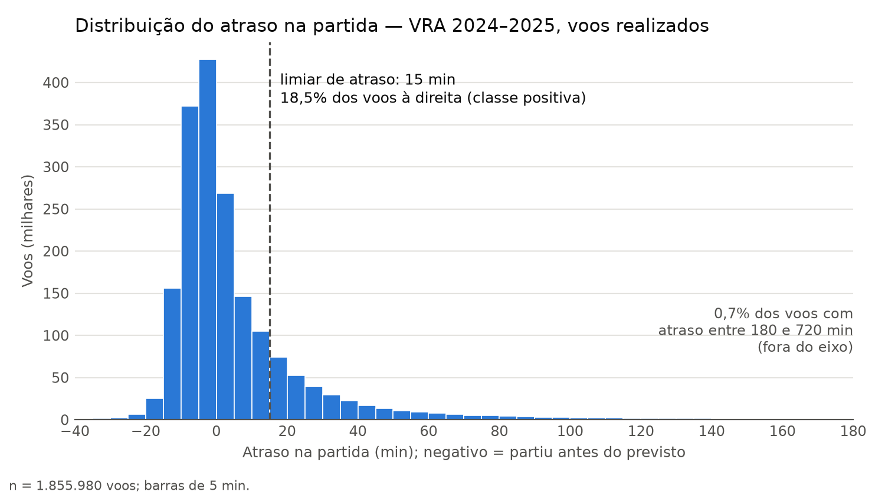
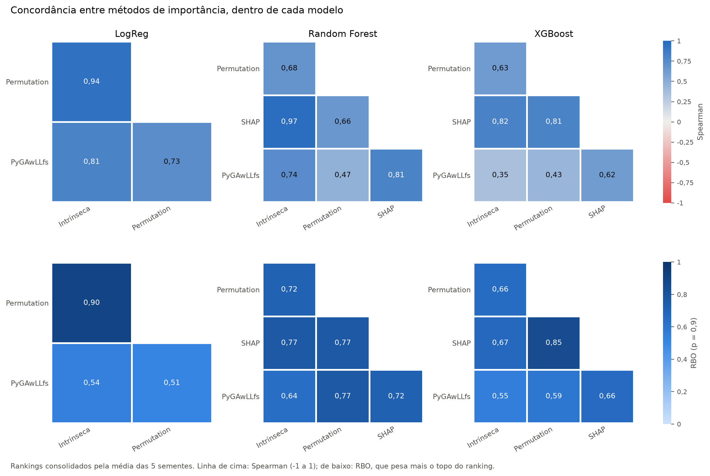
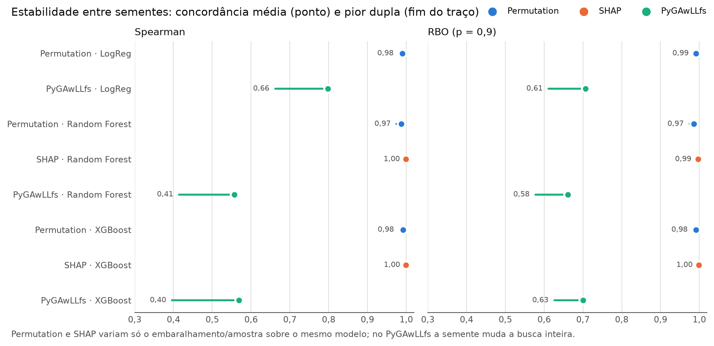
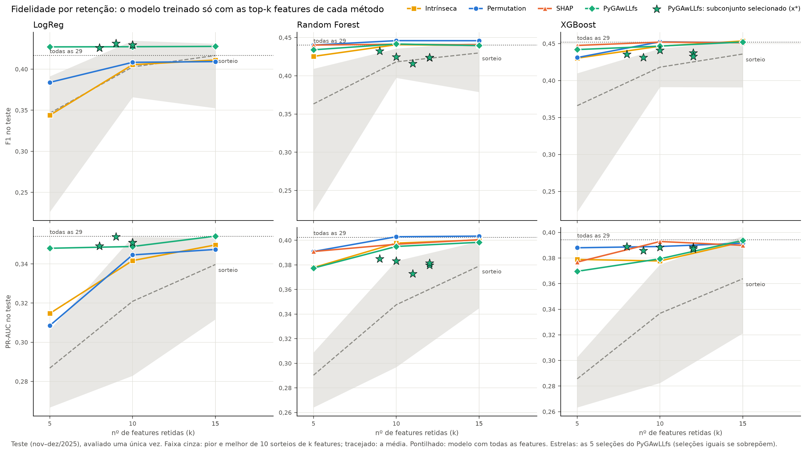
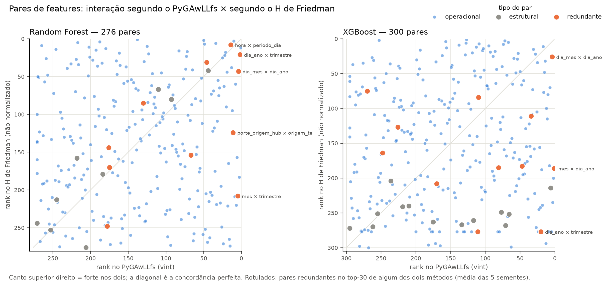
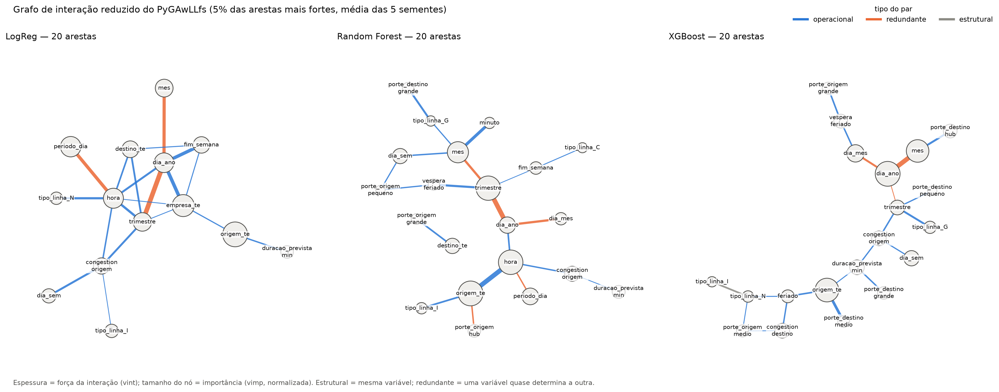
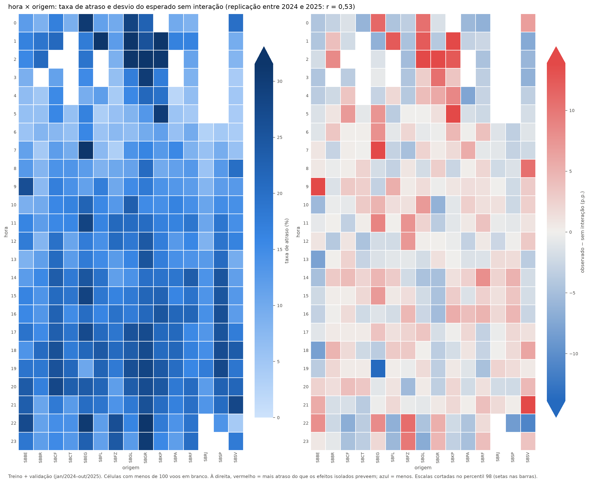

# Métodos de importância e interação de atributos na previsão de atrasos de voos

**Relatório final do projeto** · Igor Pio · orientador: Prof. Dr. Renato Tinós · FFCLRP/USP · outubro de 2026

## Resumo

Este trabalho compara cinco formas de medir **quais atributos importam** e
**quais interagem** num modelo de aprendizado de máquina, usando como problema
a previsão de atrasos de voos no Brasil (base VRA da ANAC, 2024–2025, 1,86
milhão de voos). O método central é o **PyGAwLLfs**, um algoritmo genético que
seleciona atributos e, estima a importância de cada um e a interação
entre pares. Ele foi comparado com **Permutation Importance**, **TreeSHAP**, as
**importâncias intrínsecas** dos modelos e, para interações, a **estatística H
de Friedman**, em três modelos (regressão logística, Random Forest e XGBoost) e
por quatro critérios: **concordância, estabilidade, fidelidade e custo**.

Principais resultados:

- **Os métodos concordam sobre o que importa**: aeroporto de origem, empresa e
  hora lideram quase todos os rankings. A concordância é maior entre métodos
  aplicados ao mesmo modelo (Spearman 0,70) do que entre modelos diferentes
  (0,56–0,60).
- **Todos apontam atributos que carregam a informação**: só com as 5 features
  mais importantes de cada método, o modelo retém 87%–98% do PR-AUC do modelo
  completo no teste, contra 72%–81% de 5 features sorteadas.
- **Os métodos discordam sobre o que interage**: PyGAwLLfs e H de Friedman
  quase não concordam (Spearman ≈ 0,1). Num dataset sintético com gabarito, os
  dois encontram a interação verdadeira, mas só o PyGAwLLfs trata **pares
  redundantes** como interação.
- **O custo difere em duas ordens de grandeza**: 5,4 h e milhares de treinos
  para o PyGAwLLfs, contra segundos a minutos e nenhum treino para os demais.
- Ao adaptar o PyGAwLLfs, foram corrigidos três problemas metodológicos do
  protocolo original e **dois bugs de implementação** do repositório.

## 1. Objetivo e perguntas de pesquisa

**Pergunta principal.** Como diferentes métodos de estimação de importância e
interação de atributos se comparam em termos de **concordância**,
**estabilidade**, **fidelidade** e **custo computacional** no problema de
previsão de atrasos de voos?

Ela foi desdobrada em seis perguntas específicas, respondidas na seção 9:

| | Pergunta | Como foi medida |
|---|---|---|
| P1 | Os métodos apontam os mesmos atributos? A concordância depende mais do método ou do modelo explicado? | correlação entre rankings (Spearman, Kendall, RBO, top-k) |
| P2 | Os rankings se repetem quando muda a semente aleatória? | as mesmas métricas entre 5 sementes |
| P3 | Os atributos apontados como importantes realmente carregam a informação? | retreino só com o top-k, avaliado no teste |
| P4 | Quanto custa cada método? | tempo e número de treinos de modelo |
| P5 | PyGAwLLfs e H concordam sobre as interações? Qual recupera a estrutura verdadeira? | correlação entre rankings de pares; dataset sintético com gabarito |
| P6 | As interações do PyGAwLLfs correspondem a padrões reais de atraso? | teste descritivo nos dados de voo |

## 2. Dados e preparação

**Fonte.** VRA (Voo Regular Ativo) da ANAC: um registro por voo, com empresa,
aeroportos, horários previstos e realizados. Foram usados os 24 meses de
2024–2025.

**Limpeza.** Dos 1.992.832 registros, saíram os cancelados (69.496), os sem
horário (59.141), 11 fora do período e 8.204 com atraso implausível (fora de
−40 a 720 min, erros de data). Restaram **1.855.980 voos**.

**Alvo.** `atrasado = 1` se a partida real ocorreu 15 minutos ou mais depois da
prevista (critério usual da aviação): **18,5%** dos voos. A classe é
desbalanceada, o que orienta a escolha das métricas (F1 e PR-AUC, não acurácia).

*Figura 1 — Distribuição do atraso na partida. A linha tracejada marca o limiar de 15 min.*

**Divisão temporal.** Os conjuntos foram separados por data, nunca
aleatoriamente, para simular a previsão do futuro a partir do passado:

| Conjunto | Período | Voos | Atrasados |
|---|---|---:|---:|
| Treino | jan/2024 – ago/2025 | 1.539.522 | 18,1% |
| Validação | set – out/2025 | 158.389 | 16,2% |
| Teste | nov – dez/2025 | 158.069 | 24,3% |

O teste cai no pico sazonal de fim de ano; isso foi documentado, e não
corrigido, porque o futuro tem sazonalidade.

**Atributos (29).** Todos são conhecidos antes da partida:

- **calendário e horário** da partida prevista: hora, minuto, dia da semana,
  fim de semana, período do dia, dia do mês, mês, trimestre, dia do ano,
  feriado e véspera de feriado;
- **duração prevista** do voo e **congestionamento programado** (voos previstos
  na mesma hora no aeroporto de origem e no de destino);
- **tipo de linha**, em one-hot: doméstica mista (N, passageiros), internacional
  mista (I), doméstica cargueira (C) e internacional cargueira (G), na
  codificação da ANAC (CRUZ, 2013);
- **porte** dos aeroportos de origem e destino (quartis de volume no treino,
  one-hot);
- **empresa, origem e destino** por *target encoding*: a taxa de atraso
  suavizada de cada categoria. Codificar centenas de aeroportos em one-hot
  tornaria o algoritmo genético e o H inviáveis.

**Cuidados contra vazamento de informação**, verificados por código e por
testes automáticos:

1. horários realizados, situação do voo e código de justificativa nunca entram
   como atributo (uma guarda interrompe o pipeline se aparecerem);
2. o *target encoding* do treino é calculado **fora da dobra** (5 dobras), para
   que nenhum voo use o próprio rótulo;
3. porte e encoding são ajustados só no treino e aplicados sem reajuste nos
   outros conjuntos;
4. o **teste só é usado em dois momentos**: a avaliação final dos modelos e o
   experimento de fidelidade. Todos os métodos de importância e interação são
   calculados na validação.

## 3. Modelos preditivos

Foram usados três modelos de complexidade crescente, todos com balanceamento
de classe e semente fixa. Os hiperparâmetros foram escolhidos pelo F1 na
validação, e cada modelo final foi avaliado **uma única vez** no teste.

| Modelo | Configuração fixa | Grade testada | Escolhido |
|---|---|---|---|
| Regressão logística | atributos padronizados | C ∈ {0,1; 1; 10} | C = 1 |
| Random Forest | 100 árvores | profundidade 10 (a do artigo original) | profundidade 10 |
| XGBoost | 300 árvores, taxa 0,1, GPU | profundidade ∈ {4, 6, 8} | profundidade 8 |

**Desempenho no teste:**

| Modelo | F1 | PR-AUC | ROC-AUC | Acurácia balanceada |
|---|---:|---:|---:|---:|
| Trivial (sempre "não atrasa") | 0,000 | 0,243 | 0,500 | 0,500 |
| Regressão logística | 0,417 | 0,354 | 0,644 | 0,602 |
| Random Forest | 0,440 | **0,403** | **0,682** | 0,602 |
| XGBoost | **0,452** | 0,394 | 0,676 | **0,624** |

Os dois modelos de árvores ficam praticamente empatados (diferenças de 0,01 a
0,02) e à frente da regressão logística. O desempenho é moderado, como
esperado: clima e propagação de atrasos entre voos, duas causas importantes de
atraso, ficaram de fora de propósito, porque dependem de informação posterior
à partida ou de bases externas. O objetivo do trabalho não é o melhor preditor, mas modelos
razoáveis cujas explicações possam ser comparadas.

## 4. Métodos comparados

| Método | O que mede | Retreina o modelo? | Onde é calculado |
|---|---|---|---|
| **PyGAwLLfs** | quanto o desempenho muda ao ligar ou desligar atributos (importância) e pares de atributos (interação) | sim, milhares de vezes | subamostra de 50 mil voos (treino e validação) |
| **Permutation** | queda do F1 ao embaralhar um atributo | não | validação |
| **TreeSHAP** | contribuição média de cada atributo à previsão (RF e XGBoost) | não | 10 mil linhas da validação |
| **Intrínseca** | coeficiente padronizado (LogReg), redução de impureza (RF), ganho (XGBoost) | não | o próprio modelo |
| **H de Friedman** | quanto a previsão conjunta de um par não é a soma dos efeitos isolados (só interação) | não | 500 linhas da validação |

### 4.1 PyGAwLLfs

Um algoritmo genético procura o melhor subconjunto de atributos. Cada
indivíduo é um vetor de 29 bits (bit 1 = atributo usado), e o *fitness* é

> fitness = 0,98 · F1 na validação + 0,02 · (fração de atributos descartados).

A cada geração, além do cruzamento e da mutação, o *linkage learning* sorteia
dois atributos g e h de um indivíduo x e avalia três variantes, invertendo o
bit de g, o de h e os dois (ligando o atributo que estava desligado, ou o
contrário). Dessas avaliações saem:

- **importância** de g: a maior variação de fitness já observada ao inverter g;
- **interação** de (g, h): o quanto inverter os dois juntos difere da soma de
  inverter cada um, ou seja, a **não aditividade do desempenho**.

O resultado final de cada execução é o melhor subconjunto (**x\***), um vetor
de importância e uma matriz de interação. Foram usados os parâmetros do artigo
original (população 50, 100 gerações) e 5 sementes por modelo (15 execuções).

**Correções feitas** (todas por subclasse, sem editar o repositório original,
e cobertas por testes):

| # | Problema no original | Correção |
|---|---|---|
| 1 | o fitness é calculado no conjunto de **teste**: a busca otimiza sobre o conjunto de avaliação | fitness na **validação** |
| 2 | fitness por **acurácia**: com 18% de atrasos, "nunca atrasa" tem ~76% de acurácia | **F1** |
| 3 | divisão **aleatória** dos dados | divisão **temporal** |
| 4 | *bug*: a mutação devolve um vetor novo que é ignorado, então nenhum bit é invertido | mutação no próprio vetor |
| 5 | *bug*: o elitismo grava o melhor indivíduo na população antiga, que é descartada | elitismo na população nova |

Uma consequência da correção 1: o F1 de validação do melhor indivíduo é
otimista (o subconjunto foi escolhido olhando para ele). Por isso o
desempenho do x\* só é reportado no teste (seção 6.4).

### 4.2 H de Friedman

Para um par de atributos (j, k), compara a **dependência parcial conjunta**
(como a previsão varia com j e k juntos) com a soma das individuais. Foi
calculado na escala logit, em que a regressão logística é exatamente aditiva
(H = 0 por construção; por isso só RF e XGBoost entram). A versão principal é
a não normalizada (H_abs), mais estável. Por custo, o H foi calculado só para
a união entre o top-15 de importância por consenso e todos os atributos do
grafo de interação do PyGAwLLfs: 24 atributos (276 pares) no RF e 25 (300
pares) no XGBoost. A união garante que os atributos apontados pelo PyGAwLLfs
não fiquem de fora da comparação.

## 5. Como os resultados foram obtidos

**Rankings.** Cada método produz uma importância por atributo. Para cada par
(método, modelo), as 5 sementes (42 a 46) foram resumidas pela média,
gerando 11 rankings: 4 métodos × 3 modelos, menos o SHAP da regressão
logística, que repetiria o coeficiente. As escalas dos métodos não são
comparáveis (queda de F1, diferença de fitness, unidades de logit), então
**toda comparação é por posição no ranking**, nunca por valor.

**Concordância (P1).** Para cada par de rankings: Spearman, Kendall tau-b
(trata empates), **RBO** com p = 0,9 (dá mais peso ao topo, onde a decisão
acontece: as 10 primeiras posições respondem por ~86% do valor) e a
sobreposição dos top-5, top-10 e top-15. Os 55 pares de rankings foram
separados em três grupos: métodos diferentes no **mesmo modelo** (a
comparação principal), o **mesmo método** em modelos diferentes, e **tudo
diferente**. Isso separa a divergência causada pelo método da causada pelo
modelo.

**Estabilidade (P2).** As mesmas métricas, entre as 10 duplas de sementes de
cada método. A intrínseca é determinística e fica de fora.

**Fidelidade (P3).** Se um método diz que certos atributos são os mais
importantes, um modelo treinado **só com eles** deve chegar perto do modelo
completo. Para cada modelo, o mesmo algoritmo com os mesmos hiperparâmetros
foi retreinado no treino completo com: o top-5, top-10 e top-15 de cada método;
o x\* de cada execução do PyGAwLLfs; e **10 sorteios aleatórios** de k
atributos, como referência de acaso. Foram 138 treinos, avaliados no teste.
A medida é a **fração do PR-AUC do modelo completo** que se mantém. O PR-AUC
não depende de limiar, por isso é mais estável que o F1.

**Custo (P4).** Tempo de cada execução e, como medida independente da máquina,
o **número de treinos de modelo**. Máquina: notebook com Intel Core i7, 14 GB
de RAM e GPU RTX 4050 (usada só pelo XGBoost).

**Dataset sintético (P5).** 5.000 exemplos com estrutura conhecida:

> z = 2·x1·x2 + x3 + x4 + 0,5·ruído; y = 1 se z > 0.

Nele, x1 e x2 só agem juntos (**interação pura**), x3 e x4 têm efeito aditivo,
x5 e x6 são **cópias correlacionadas** (ρ = 0,9) de x3 e x4, e x7–x10 são ruído.
Todos os métodos rodaram com o mesmo código usado nos dados reais, e cada
resultado foi comparado com esse gabarito.

**Validação de domínio (P6).** Para os pares do topo do PyGAwLLfs (top-10 de
cada modelo, 25 pares), mais 10 pares do fundo do ranking como controle:

1. cada par foi classificado como **estrutural** (duas codificações da mesma
   variável), **redundante** (uma variável quase determina a outra) ou
   **operacional**;
2. para os operacionais, a taxa de atraso em cada célula do cruzamento das
   duas variáveis foi comparada com a prevista por um modelo **só com os
   efeitos isolados**;
3. o par é **corroborado descritivamente** se, em 2024 **e** em 2025, o desvio
   médio supera o ruído amostral (bootstrap) e 1 ponto percentual, e se o
   padrão de desvios se repete entre os dois anos (correlação ≥ 0,5).

Essa análise usa só treino e validação. Corroborar não é provar causa: um
fator não observado pode produzir o mesmo padrão.

**Reprodutibilidade.** Todo o pipeline roda com um comando (`python main.py`,
~7,5 h, quase tudo no PyGAwLLfs), com retomada por checkpoint. Há 8 suítes de
testes automáticos (40 testes). Entre outras coisas, elas verificam que nenhum
método abre o conjunto de teste, que os dois bugs existem no original e foram
corrigidos, que o H acerta funções com resposta conhecida e que as tabelas
finais reproduzem as fontes.

## 6. Resultados

### 6.1 O que os métodos apontam como importante

Top-5 de cada ranking:

| Modelo | Método | 1º | 2º | 3º | 4º | 5º |
|---|---|---|---|---|---|---|
| LogReg | Intrínseca | dia do ano | mês | dia do mês | origem | empresa |
| LogReg | Permutation | dia do ano | dia do mês | mês | origem | fim de semana |
| LogReg | PyGAwLLfs | origem | empresa | período do dia | hora | dia do ano |
| RF | Intrínseca | empresa | origem | hora | duração prevista | período do dia |
| RF | Permutation | origem | hora | empresa | dia do ano | período do dia |
| RF | SHAP | hora | origem | empresa | período do dia | dia do ano |
| RF | PyGAwLLfs | origem | hora | trimestre | mês | empresa |
| XGBoost | Intrínseca | empresa | hora | linha C (dom. cargueira) | origem | linha I (intern. mista) |
| XGBoost | Permutation | hora | empresa | origem | congest. origem | duração prevista |
| XGBoost | SHAP | hora | empresa | dia do ano | origem | dia da semana |
| XGBoost | PyGAwLLfs | dia do ano | hora | origem | mês | empresa |

Aeroporto de origem, empresa e hora aparecem no top-5 de quase todos. Na
regressão logística, intrínseca e Permutation são dominadas por atributos de
calendário colineares (dia do ano ≈ 30·mês + dia do mês): os coeficientes de
`dia_ano` e `mes` são grandes e de sinais opostos e se anulam. O PyGAwLLfs,
que retreina o modelo sem cada atributo, não cai nessa armadilha.

### 6.2 Concordância

*Figura 2 — Concordância entre os métodos dentro de cada modelo: Spearman (em cima) e RBO (embaixo).*

| Tipo de comparação | Spearman | RBO | Top-5 em comum |
|---|---:|---:|---:|
| Métodos diferentes, mesmo modelo | **0,70** | 0,69 | 67% |
| Mesmo método, modelos diferentes | 0,60 | 0,61 | 56% |
| Método e modelo diferentes | 0,56 | 0,60 | 62% |

- A concordância é **moderada a alta** e maior dentro do mesmo modelo: o
  modelo explicado pesa tanto quanto o método.
- **Cai com a complexidade do modelo**: Spearman médio entre os métodos de 0,83
  na LogReg, 0,72 no RF e 0,61 no XGBoost.
- O **PyGAwLLfs é o que menos concorda** com os outros (0,62 nas duplas com
  ele, contra 0,79 nas duplas sem ele). Exceção: no RF, a Permutation tem o
  menor Spearman (0,60), mas o maior RBO (0,75, empatada com o SHAP). Ela
  concorda no topo e diverge na cauda, onde dá valores nulos ou levemente
  negativos (sem efeito detectável), e a ordem entre eles é arbitrária.

### 6.3 Estabilidade

*Figura 3 — Estabilidade entre sementes: ponto = média nas 10 duplas de sementes; traço até o pior caso.*

- **Permutation e SHAP** praticamente não mudam com a semente (Spearman
  0,99–1,00): sobre um modelo fixo, a semente só muda o embaralhamento ou a
  amostra.
- **PyGAwLLfs**: 0,80 na LogReg, 0,56 no RF e 0,57 no XGBoost. Aqui a semente
  muda a busca inteira. O topo é mais firme que a cauda: 68%–84% do top-5 se
  repete entre execuções.
- A **matriz de interação** do PyGAwLLfs não se repete entre execuções
  (Spearman ≈ 0), enquanto a do H fica em 0,93–0,98. Com 29 atributos há 406
  pares, e cada execução faz ~300 sondagens. Cada par é sondado, em média,
  0,7 vez, e metade fica sem nenhuma medição.

### 6.4 Fidelidade

*Figura 4 — Fidelidade no teste: desempenho do modelo retreinado só com as top-k features de cada método. Faixa cinza = sorteios aleatórios; estrelas = x\* do PyGAwLLfs.*

Fração do PR-AUC do modelo completo retida no teste:

| Modelo | k | Intrínseca | Permutation | SHAP | PyGAwLLfs | Sorteio |
|---|---:|---:|---:|---:|---:|---:|
| LogReg | 5 | 89% | 87% | — | **98%** | 81% |
| LogReg | 10 | 96% | 97% | — | **99%** | 91% |
| RF | 5 | 94% | **97%** | **97%** | 94% | 72% |
| RF | 10 | 99% | **100%** | 99% | 98% | 86% |
| XGBoost | 5 | 96% | **98%** | 96% | 94% | 72% |
| XGBoost | 10 | 96% | 99% | **100%** | 96% | 85% |

- **Todos os métodos ficam muito acima do acaso** no top-5 (+6 a +26 pontos
  percentuais). Com k = 15, todos retêm 98%–100%: a maior parte da informação
  está em poucos atributos.
- **Permutation** é a mais fiel no RF e no XGBoost; **PyGAwLLfs** é a mais fiel
  na regressão logística. O top-5 da intrínseca na LogReg retinha 96% do F1 na
  validação e caiu para 82,5% no teste: efeitos de calendário aprendidos em
  outras estações não se transferem para novembro e dezembro.
- O **x\* do PyGAwLLfs**, com cerca de um terço dos atributos (9 a 11, em
  média), retém 99% (LogReg), 95% (RF) e 98% (XGBoost) do PR-AUC.

### 6.5 Custo

| Método | Por execução | Treinos por execução | Total (3 modelos, 5 sementes) |
|---|---:|---:|---:|
| Intrínseca | < 2 s | 0 | ~2 s |
| Permutation (29 atributos × 10 repetições) | 17–28 s | 0 | 5,4 min |
| TreeSHAP (10 mil linhas) | 2 s (XGBoost) – 2,3 min (RF) | 0 | 11,7 min |
| H de Friedman (até 300 pares) | 33–49 s | 0 | 6,8 min |
| **PyGAwLLfs** | 5,4 min (LogReg) – 33 min (XGBoost) | **3.200–4.400** | **5,4 h** |

Os quatro primeiros explicam um modelo já treinado. O PyGAwLLfs retreina o
modelo milhares de vezes, mesmo numa subamostra de 50 mil voos. Em troca,
entrega também a seleção de atributos (x\*) e a matriz de interação.

### 6.6 Quadro-síntese dos quatro critérios

| Modelo | Método | Concordância¹ | Estabilidade² | Fidelidade top-5³ | Custo por execução |
|---|---|---:|---:|---:|---:|
| LogReg | Intrínseca | 0,88 | determinística | 89% | < 1 s |
| LogReg | Permutation | 0,84 | 0,99 | 87% | 17 s |
| LogReg | PyGAwLLfs | 0,77 | 0,80 | **98%** | 5,4 min · 3.216 treinos |
| RF | Intrínseca | 0,80 | determinística | 94% | < 1 s |
| RF | Permutation | 0,60 | 0,99 | **97%** | 28 s |
| RF | SHAP | 0,81 | 1,00 | **97%** | 2,3 min |
| RF | PyGAwLLfs | 0,67 | 0,56 | 94% | 26 min · 4.041 treinos |
| XGBoost | Intrínseca | 0,60 | determinística | 96% | 2 s |
| XGBoost | Permutation | 0,62 | 0,99 | **98%** | 19 s |
| XGBoost | SHAP | 0,75 | 1,00 | 96% | 2 s |
| XGBoost | PyGAwLLfs | 0,47 | 0,57 | 94% | 33 min · 4.400 treinos |

¹ Spearman médio com os outros métodos do mesmo modelo.
² Spearman médio entre as 10 duplas de sementes.
³ Fração do PR-AUC do modelo completo retida no teste; sorteio: 81% (LogReg),
72% (RF e XGBoost).

Comparando os modelos pelas explicações: quanto mais complexo o modelo, menos
os métodos concordam entre si (0,83 → 0,72 → 0,61), mas maior é o ganho do
top-5 sobre o acaso. Na LogReg, 5 atributos quaisquer já retêm 81%; no RF e no
XGBoost, só 72%, e os métodos chegam a 94%–98%.

### 6.7 Interações: PyGAwLLfs × H de Friedman

*Figura 5 — Cada ponto é um par de atributos: posição no ranking de interação do PyGAwLLfs (x) contra a do H (y).*

| Modelo | Spearman | RBO | Top-10 em comum | Estabilidade PyGAwLLfs | Estabilidade H |
|---|---:|---:|---:|---:|---:|
| RF | 0,12 | 0,07 | 1 de 10 | −0,01 | 0,98 |
| XGBoost | 0,08 | 0,02 | 0 de 10 | 0,00 | 0,93 |

Os dois métodos praticamente não concordam, por duas causas:

1. **Confiabilidade.** Com o orçamento do artigo e 29 atributos, a matriz do
   PyGAwLLfs é pouco confiável (seção 6.3). Somar mais 5 sementes elevaria a
   confiabilidade da média apenas de ~0,2 para ~0,3.
2. **Conceitos diferentes.** O PyGAwLLfs mede a não aditividade do
   **desempenho**; o H, a da **função** do modelo. Atributos redundantes geram a
   primeira e não a segunda: tirar um só não custa, porque o outro compensa,
   mas tirar os dois custa. Nos dados reais, 8 das 15 arestas mais fortes do
   PyGAwLLfs (top-5 de cada modelo) são pares redundantes de calendário, como
   mês × dia do ano e hora × período do dia.

### 6.8 Dataset sintético (gabarito conhecido)

**Importância** (RF e XGBoost):

| Método | Separa relevantes¹ de ruído (AUC) | Rank médio de x1, x2 (interação pura) |
|---|---:|---:|
| PyGAwLLfs | **1,00** | **1,5** |
| Intrínseca | 1,00 | 3,5 |
| SHAP | 1,00 | 3,5 (XGBoost) – 5,5 (RF) |
| Permutation | 0,83 – 0,91 | **1,5** |

¹ Relevantes: as diretas (x1–x4) e as redundantes (x5, x6), que são proxies
legítimos do alvo.

- Só o PyGAwLLfs combina as duas propriedades: separa perfeitamente o
  relevante do ruído **e** põe o par de interação no topo.
- A Permutation é a mais fraca na separação. Num modelo fixo, embaralhar uma
  redundante quase não muda a previsão, porque a original compensa.
- Na LogReg, todos os métodos põem x1 e x2 atrás das aditivas e das
  redundantes (rank ~6 de 10). É limitação do modelo linear, que não consegue
  usar uma interação pura, e não dos métodos.

**Interação** (45 pares):

| Método | Posição de (x1, x2) | Posição média dos pares redundantes (x3, x5), (x4, x6) |
|---|---:|---:|
| PyGAwLLfs (RF, XGBoost) | 1º em todas as sementes | **2,5º** |
| H_abs (RF / XGBoost) | 1º em todas as amostras | 7º / 20º |
| H normalizado (RF / XGBoost) | 1º | 28,5º / 44,5º |

Os dois encontram a interação verdadeira; **só o PyGAwLLfs põe a redundância
logo abaixo dela**. Isso confirma a hipótese da seção 6.7: não é um defeito,
mas outra definição de interação, e é útil para seleção de atributos, porque
indica pares substituíveis.

**Seleção (x\*).** O RF selecionou exatamente {x1, x2, x3, x4} (F1 = 1,0); o
XGBoost acrescentou uma redundante (F1 = 0,89). A LogReg incluiu um ruído (F1 =
0,5), sinal do otimismo de escolher o subconjunto pela validação.

### 6.9 Validação de domínio das interações

*Figura 6 — Grafo de interação reduzido do PyGAwLLfs (5% das arestas mais fortes), com cada aresta classificada como operacional, redundante ou estrutural.*

| Grupo | Pares | Estrutural | Redundante | Operacional | Corroborados |
|---|---:|---:|---:|---:|---:|
| Candidatos (topo do PyGAwLLfs) | 25 | 1 | 5 | 19 | **2** |
| Controles (fundo do ranking) | 10 | 0 | 0 | 10 | 0 |

- **Corroborados descritivamente:** hora × aeroporto de origem e hora × tipo de
  linha.
- Os candidatos têm interações descritivas maiores que os controles. Desvio
  médio dos operacionais: 0,88 e 0,71 ponto percentual (2024 e 2025), contra
  0,26 e 0,27 nos controles.
- Mas só 2 dos 19 candidatos operacionais passam no critério completo. Aplicado
  ao top-10 do H, o mesmo teste corroborou **9 de 20 pares**, contra **1 de 20**
  do PyGAwLLfs. Parte dessa vantagem é esperada, porque o H e o teste usam a
  mesma definição de interação.

*Figura 7 — Hora × aeroporto de origem. À esquerda, a taxa de atraso observada; à direita, observado menos o previsto sem interação.*

Partidas de madrugada em Guarulhos (2h: 41% de atraso, contra 25% previstos
sem interação) e no Galeão atrasam muito mais do que "ser esse aeroporto" e
"ser essa hora" explicariam somados. O padrão é compatível com bancos noturnos
de voos internacionais longos. Em Congonhas às 22h ocorre o contrário (−8,6
p.p.), compatível com a restrição de horário de operação do aeroporto.

No segundo par corroborado, hora × tipo de linha, o efeito da hora **muda de
sinal** conforme o tipo de voo:

- os **cargueiros domésticos** (C) das 2h–3h atrasam 45%–51%, contra 17%–22%
  previstos sem interação, e os das 22h quase não atrasam (7% contra 28%);
- os **internacionais de passageiros** (I) das 5h–6h atrasam o dobro do
  previsto (32% contra ~16%), o mesmo padrão de madrugada do par anterior;
- os **domésticos de passageiros** (N), que são a maioria dos voos, seguem o
  padrão aditivo.

O padrão é plausível, porque a programação e as prioridades de um voo de carga
diferem das de um voo de passageiros. Todas essas leituras são hipóteses de
domínio, não verificadas aqui.

## 7. Limitações

- **Um conjunto de dados e um período de teste** (nov–dez, pico sazonal), que
  penaliza rankings baseados em calendário.
- **Orçamento do PyGAwLLfs:** os parâmetros do artigo deixam a matriz de
  interação esparsa com 29 atributos. A importância é bem mais estável
  (0,56–0,80), e o topo dela se mantém.
- **H de Friedman e atributos dependentes:** a dependência parcial avalia
  combinações que não existem nos dados (ex.: hora 3 com período "tarde"),
  inflando o H de alguns pares de calendário no RF.
- **Validação de domínio observacional:** corroboração não é causalidade, e
  ficou restrita aos 15 maiores aeroportos e às 10 maiores empresas.
- **Atributos:** o congestionamento conta só voos realizados, não os
  programados. O impacto medido é de ±0,002 no F1, então ficou como limitação
  documentada.
- **Fora do escopo por decisão:** clima, propagação de atrasos entre voos e
  fidelidade por remoção (ROAR).

## 8. Conclusões

1. **Sobre importância, os métodos convergem.** Origem, empresa e hora lideram
   quase todos os rankings, e o top-5 de qualquer método retém 87%–98% do
   desempenho. A maior fonte de divergência é o **modelo explicado**, não o
   método: compare métodos dentro do mesmo modelo antes de comparar modelos.
2. **Para ranquear importância num modelo já treinado, Permutation e SHAP são
   a melhor relação custo-benefício**: estáveis, fiéis e baratos. A intrínseca
   é instantânea, mas sofre com colinearidade na regressão logística.
3. **O PyGAwLLfs custa duas ordens de grandeza a mais, mas faz outra coisa.**
   Ele seleciona atributos (x\* com um terço das features retém 95%–99% do
   PR-AUC), é robusto à colinearidade (o mais fiel na LogReg) e foi o que
   melhor recuperou a estrutura do sintético no RF e no XGBoost. Sua
   importância é menos estável entre sementes, mas o topo se mantém.
4. **Sobre interações, os métodos divergem, e a divergência tem explicação.**
   O PyGAwLLfs mede a não aditividade do desempenho e, por isso, também detecta
   **redundância**. O H mede a não aditividade da função do modelo. Os dois
   acham a interação verdadeira quando ela existe.
5. **A matriz de interação do PyGAwLLfs precisa de mais sondagens** do que o
   orçamento do artigo oferece com ~30 atributos. Com 10 atributos (sintético),
   a cobertura é total e o método funciona bem.
6. **Do grafo de interação saíram dois padrões operacionais plausíveis**
   (hora × aeroporto e hora × tipo de linha). Para extrair conhecimento de
   domínio, porém, o topo do grafo precisa ser filtrado: metade das arestas
   mais fortes é redundância.
7. **Contribuições metodológicas:** a correção do protocolo do PyGAwLLfs
   (fitness na validação, F1, divisão temporal), a identificação e correção de
   dois bugs do código original, e um protocolo que separa redundância de
   interação usando um gabarito sintético.

**Trabalhos futuros:** aumentar as sondagens de *linkage learning* por geração;
versões do H robustas a atributos dependentes; incluir clima e propagação de
atrasos; repetir o protocolo em outros períodos de teste.

## 9. Respostas às perguntas de pesquisa

**P1 — Os métodos apontam os mesmos atributos? Depende mais do método ou do
modelo?**
Sim, em grande parte. A concordância é moderada a alta (Spearman 0,70 dentro do
mesmo modelo), e o núcleo é comum: origem, empresa e hora. Depende **mais do
modelo do que do método**: o mesmo método em modelos diferentes concorda menos
(0,60) que métodos diferentes no mesmo modelo (0,70). A concordância também cai
com a complexidade do modelo (0,83 → 0,72 → 0,61). O PyGAwLLfs é o que mais
diverge (0,62 contra 0,79 nas duplas sem ele).

**P2 — Os rankings se repetem com outra semente?**
Para Permutation e SHAP, sim (0,99–1,00), e a intrínseca é determinística. Para
o PyGAwLLfs, só em parte: 0,56–0,80 no ranking inteiro, mas 68%–84% do top-5 se
repete. A matriz de interação do PyGAwLLfs não se repete (≈ 0) com o orçamento
do artigo; a do H, sim (0,93–0,98).

**P3 — Os atributos apontados como importantes carregam a informação?**
Sim, para todos os métodos. O top-5 retém 87%–98% do PR-AUC no teste, contra
72%–81% do acaso, e o top-10, 96%–100%. Os mais fiéis são a Permutation no RF e
no XGBoost (97%–98%) e o PyGAwLLfs na regressão logística (98%). O x\* do
PyGAwLLfs retém 95%–99% com um terço dos atributos.

**P4 — Quanto custa cada método?**
Intrínseca: instantânea. Permutation: 17–28 s. TreeSHAP: 2 s a 2,3 min. H de
Friedman: 33–49 s por amostra. Nenhum deles retreina o modelo. O PyGAwLLfs leva
5–33 min e 3.200–4.400 treinos por execução (5,4 h no protocolo), duas ordens de
grandeza a mais, em troca de também selecionar atributos e estimar interações.

**P5 — PyGAwLLfs e H concordam sobre as interações? Qual recupera a verdade?**
Não concordam nos dados reais (Spearman 0,08–0,12). No sintético, **os dois
recuperam a interação verdadeira** (1º lugar em todas as execuções). A
diferença está na redundância: o PyGAwLLfs a põe logo abaixo da interação
verdadeira (2º–3º), e o H não (7º–44º). O PyGAwLLfs mede não aditividade do
desempenho; o H, não aditividade da função. Nos dados reais, a matriz do
PyGAwLLfs é, além disso, pouco confiável com 29 atributos.

**P6 — As interações do PyGAwLLfs correspondem a padrões reais?**
Parcialmente. Os pares do topo têm interações descritivas maiores que os do
fundo, e dois foram corroborados nos dois anos: hora × aeroporto de origem e
hora × tipo de linha. Nenhum controle foi corroborado. Mas só 2 de 19 pares
operacionais passaram, 6 dos 25 pares do topo são redundância ou estrutura, e o
top-10 do H teve mais pares corroborados (9 de 20, contra 1 de 20).

**Pergunta principal — como os métodos se comparam nos quatro critérios?**

- **Concordância:** convergem sobre o que importa (Spearman 0,70 no mesmo
  modelo). O modelo explicado pesa mais que o método, e o PyGAwLLfs é o mais
  divergente.
- **Estabilidade:** Permutation e SHAP ≈ 1; PyGAwLLfs 0,56–0,80, com o topo
  firme. Nas interações, o H é estável e a matriz do PyGAwLLfs não.
- **Fidelidade:** todos ficam muito acima do acaso. Os mais fiéis são a
  Permutation (RF e XGBoost) e o PyGAwLLfs (LogReg).
- **Custo:** o PyGAwLLfs custa duas ordens de grandeza a mais que os demais.

Em síntese, os métodos **concordam sobre o que importa e discordam sobre o que
interage**. Para explicar um modelo já treinado, Permutation e SHAP têm a
melhor relação entre estabilidade, fidelidade e custo. O PyGAwLLfs é menos
estável e muito mais caro, mas é o único que seleciona atributos, o mais
robusto à colinearidade e o que melhor recuperou a estrutura do dataset
sintético. Sua noção de interação inclui a redundância, o que o torna
complementar, e não substituto, ao H de Friedman.

## Apêndice — Onde está cada coisa

| O quê | Onde |
|---|---|
| Rodar tudo | `python main.py` (`--listar` mostra as 12 etapas e o tempo de cada uma) |
| Testes | `python main.py --testes` ou `python tests/test_*.py` |
| Tabelas de resultados | `results/tables/` (o quadro-síntese em `sintese_*.csv`) |
| Figuras (PNG e PDF) | `results/figures/` |
| Regras metodológicas | `docs/metodologia.md` |
| Detalhe de cada resultado | `docs/fidelidade.md`, `docs/interacoes-h.md`, `docs/sintetico.md`, `docs/validacao-dominio.md` |
| Dados e atributos | `docs/preparacao-dados.md`, `docs/dicionario-features.md` |
| PyGAwLLfs e as correções | `docs/metodologia.md` §4, `src/importance/gawll.py` |
| Decisões em aberto | `docs/decisoes.md` |

## Referências

CRUZ, C. S. BAV – Boletim de Alteração de Voos. In: SEMANA DE QUALIDADE DA
INFORMAÇÃO DO TRANSPORTE AÉREO, 1., 2013, São Paulo. *Apresentação*. Brasília,
DF: ANAC, 2013. Disponível em:
https://www.gov.br/anac/pt-br/assuntos/regulados/empresas-aereas/semana-de-qualidade-da-informacao-do-transporte-aereo/arquivos/i-semana/apresentacao/painel_boletim_de_alteracao_de_voos_empresas_brasileiras.pdf.
Acesso em: 13 out. 2026.

GUIMARÃES, D. G.; CARVALHO, S. S.; NASCIMENTO, R. H.; TINÓS, R. Estimating
variable importance and interaction in machine learning via genetic
algorithms. In: *BRACIS 2025*. Springer, 2026. p. 478–492. (LNAI 16179). DOI:
10.1007/978-3-032-15987-8_32.

As demais referências (algoritmo genético com *linkage learning*, estatística H,
RBO e a base VRA) estão no `README.md`.
